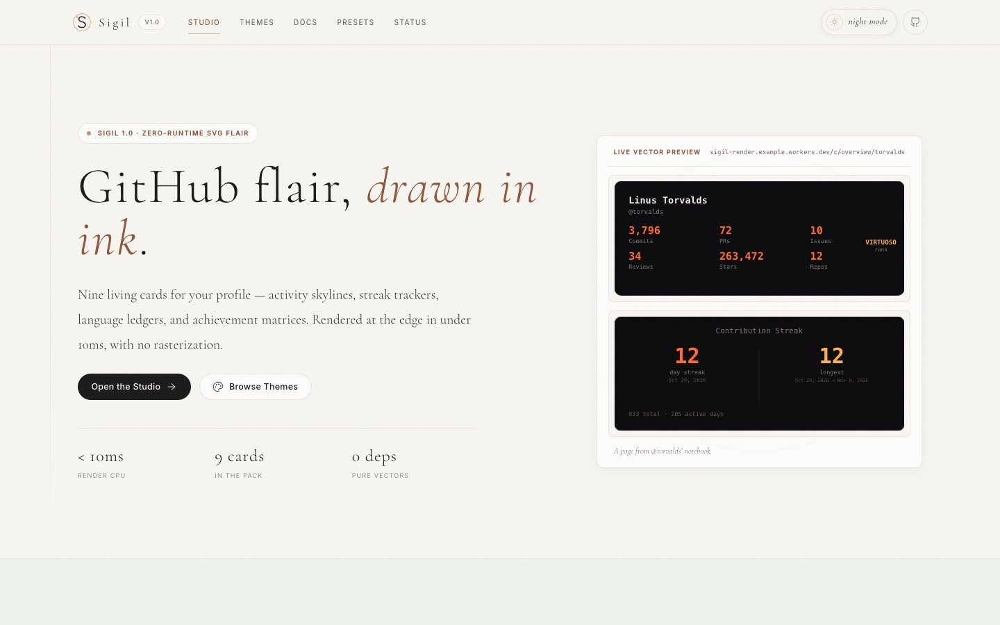
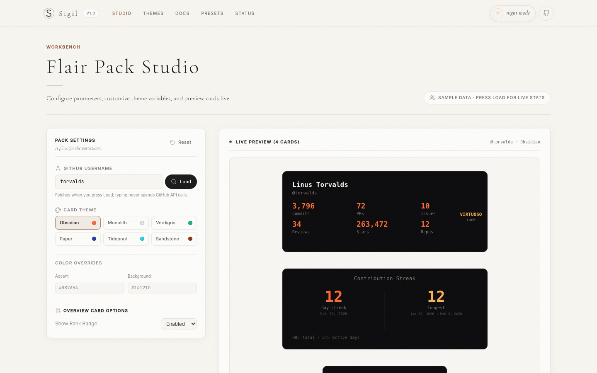
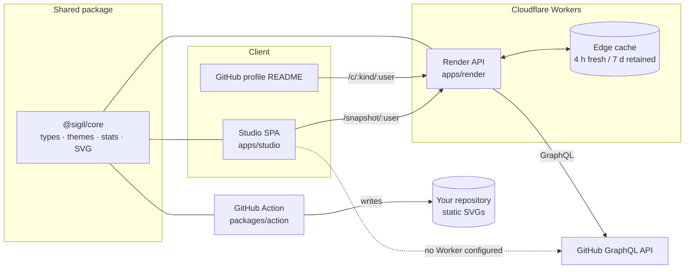

# Sigil

**Your developer sigil. Nine living cards for your GitHub profile, one line to install.**

Sigil is an open-source (MIT) studio and edge API that turns a GitHub username into nine animated SVG cards: stats and rank, contribution streak, language mix, contribution heatmap, isometric skyline, activity graph, achievements, repository card, and profile banner. Design a pack in the studio, pick a theme, and copy the Markdown into your profile README.

[](https://github.com/askarthemasss/profile-flair-studio/actions/workflows/ci.yml)
[](LICENSE)
[](CONTRIBUTING.md)

> **Current status:** the studio is live at [profile-flair-studio.vercel.app](https://profile-flair-studio.vercel.app). The render Worker is implemented and typechecked, but it is not deployed in the hosted setup yet. Without `VITE_RENDER_API_URL`, the hosted studio fetches public GitHub data directly in the browser and falls back to sample data until you press **Load**. See [Current status](#current-status) for the exact working state.

## Why Sigil

- **Nine cards, one design language.** Every card shares the same spacing, typography, and palette rules, so a pack looks intentional instead of assembled from five different tools.
- **Themes are first-class.** Six built-in themes ship with WCAG AA-validated text and accent contrast, and every card supports custom color overrides. Community theme JSON is accepted through `themes/community/`.
- **Stateless by design.** The render Worker has no database and stores no user tokens. GitHub responses are normalized in memory and cached at the edge with stale-while-revalidate.
- **A real fallback.** The studio can fetch public GitHub data without a server, and the GitHub Action can commit static SVGs to your own repository so your profile survives an outage.
- **No signup, no OAuth, no tracking.** Public data only. The studio keeps presets and theme votes in your browser's `localStorage`.

## Preview





_The landing page and the studio. The studio starts with sample data until you press **Load**._

## Cards

| Card           | What it shows                                                                   |
| -------------- | ------------------------------------------------------------------------------- |
| `overview`     | Profile summary, rank tier, and headline totals                                 |
| `streak`       | Current and longest contribution streaks, total contributions, busiest day      |
| `languages`    | Language mix by bytes and repository count, with bar, donut, or compact layouts |
| `heatmap`      | Contribution calendar with configurable weeks and month labels                  |
| `skyline`      | Isometric contribution skyline for a chosen year                                |
| `activity`     | Recent contribution activity graph                                              |
| `achievements` | Tiered milestones across consistency, volume, collaboration, and impact         |
| `repo`         | Repository card with description, stars, forks, and language                    |
| `banner`       | Wide profile banner with avatar and optional tagline                            |

Built-in themes: `obsidian`, `monolith`, `verdigris`, `paper`, `tidepool`, and `sandstone`.

## Tech stack

| Area          | Stack                                                                                                                               |
| ------------- | ----------------------------------------------------------------------------------------------------------------------------------- |
| Monorepo      | pnpm 9 workspaces, TypeScript 5 in strict mode                                                                                      |
| Studio        | React 19, Vite 8, Tailwind CSS 4, React Router 6, TanStack Query 5, Zustand 5, React Hook Form 7, Zod 4, Sonner, Lucide             |
| Core          | Framework-free TypeScript, Zod schemas, tsup/esbuild output                                                                         |
| Render API    | Hono 4 on Cloudflare Workers, Wrangler 4, Cloudflare Cache API, GitHub GraphQL                                                      |
| GitHub Action | Node 20 action with a committed esbuild bundle                                                                                      |
| Testing       | Vitest 4 (33 core tests), ESLint 9, Prettier 3                                                                                      |
| CI/CD         | GitHub Actions for typecheck, lint, tests, builds, theme validation, and SVG budgets; Vercel for the studio; Cloudflare for the API |
| Persistence   | None. No database, no user accounts, no stored GitHub tokens                                                                        |

## Architecture



### How a card request flows

1. A README embeds `GET /c/:kind/:username?theme=obsidian`.
2. The Worker validates the card kind and query parameters with the matching Zod schema.
3. It looks for a normalized snapshot in the Cloudflare Cache API and the in-isolate memory layer.
4. On a miss, it fetches public data from GitHub GraphQL with a server-side token, normalizes it, and writes the snapshot to both cache layers.
5. The card renderer turns the snapshot into an SVG string with no headless browser, canvas, or rasterization.
6. Fresh snapshots are served for 4 hours. Stale snapshots are served immediately while a background refresh runs through `waitUntil`.

The studio uses the same core package for previews, so the card you see locally is produced by the same renderer that the Worker uses.

## Repository layout

```text
.
├── apps/
│   ├── studio/              React SPA: landing, studio, themes, docs, presets, status
│   └── render/              Hono + Cloudflare Worker render API
├── packages/
│   ├── core/                Types, schemas, themes, stats, GitHub queries, nine SVG renderers
│   └── action/              GitHub Action that writes static SVG cards
├── themes/
│   └── community/           Community theme submissions
├── scripts/                 Theme validation and SVG size-budget checks
├── .github/workflows/       CI and conditional deployment workflows
├── vercel.json              Vercel configuration for the studio
└── package.json             Root scripts and workspace tooling
```

## Quick start

### Prerequisites

- **Node.js 20.19+** (CI uses Node 20; Node 22 LTS also works)
- **pnpm 9+** — run `corepack enable` once, or install pnpm from [pnpm.io](https://pnpm.io/installation)
- Git

### Run the studio

```bash
git clone https://github.com/askarthemasss/profile-flair-studio.git
cd profile-flair-studio
corepack enable
pnpm install
pnpm dev
```

Open [http://localhost:5173](http://localhost:5173). The studio starts with sample data. Type a GitHub username and press **Load** to fetch live public data. No token is required for the browser fallback.

### Connect a local render Worker (optional)

The studio is fully usable without a Worker, but live card embed URLs and server-side caching require one. In one terminal:

```bash
cp apps/render/.dev.vars.example apps/render/.dev.vars
# Add a GitHub token to apps/render/.dev.vars
pnpm --filter @sigil/render dev
```

The Worker listens on `http://localhost:8787` by default. Then point the studio at it:

```bash
cp apps/studio/.env.example apps/studio/.env
# Set VITE_RENDER_API_URL=http://localhost:8787
pnpm dev
```

See [`apps/render/README.md`](apps/render/README.md) for deployment, token scopes, cache behavior, and custom-domain notes.

## Environment variables

| Where         | Variable              | Required | Purpose                                                                                                          |
| ------------- | --------------------- | -------- | ---------------------------------------------------------------------------------------------------------------- |
| Studio build  | `VITE_RENDER_API_URL` | No       | Origin of the render Worker. When unset, the studio uses its browser-side GitHub fallback. This value is public. |
| Render Worker | `GITHUB_TOKEN`        | Yes      | GitHub token used for GraphQL reads. Set it as a Worker secret.                                                  |
| Render Worker | `GITHUB_TOKEN_POOL`   | No       | Comma-separated token pool. Takes precedence over `GITHUB_TOKEN`.                                                |
| Render Worker | `ENVIRONMENT`         | No       | Label returned by `/health`. `wrangler.toml` sets `production`.                                                  |
| GitHub Action | `github-token` input  | Yes      | Token used by the Action to fetch stats with the user's own credentials.                                         |

Copy the examples, never commit the real files:

```bash
cp apps/studio/.env.example apps/studio/.env
cp apps/render/.dev.vars.example apps/render/.dev.vars
```

`.env`, `.env.*`, `.dev.vars`, and `.dev.vars.*` are git-ignored. Only `*.example` files belong in the repository. **Never put a secret in a `VITE_*` variable** — Vite inlines those values into the public browser bundle.

## Scripts

| Command                             | What it does                                                             |
| ----------------------------------- | ------------------------------------------------------------------------ |
| `pnpm dev`                          | Start the studio dev server on port 5173                                 |
| `pnpm build`                        | Build every workspace package                                            |
| `pnpm typecheck`                    | Typecheck all packages                                                   |
| `pnpm lint`                         | Run ESLint for the studio                                                |
| `pnpm test`                         | Run the core Vitest suite                                                |
| `pnpm format`                       | Format the repository with Prettier                                      |
| `pnpm validate:themes`              | Validate theme JSON and WCAG AA text/accent contrast                     |
| `pnpm check:svg`                    | Render all nine cards, check for `NaN`, and enforce the 45 KB SVG budget |
| `pnpm --filter @sigil/render dev`   | Run the render Worker locally with Wrangler                              |
| `pnpm --filter @sigil/action build` | Rebuild the committed GitHub Action bundle                               |

### Quality gates

Every pull request runs the same checks as CI:

```bash
pnpm typecheck
pnpm lint
pnpm test
pnpm build
pnpm validate:themes
pnpm check:svg
```

CI also builds `packages/action` and validates every theme. Keep the SVG size budget in mind when adding a card: the current limit is **45 KB per SVG** before compression.

## Deployment

### Studio (Vercel)

The repository includes [`vercel.json`](vercel.json). Import the repository into Vercel, keep the project root at the repository root, and set:

- `VITE_RENDER_API_URL` — the deployed Worker origin, once it exists.

The included [deploy workflow](.github/workflows/deploy.yml) can deploy on every push to `main` when `VERCEL_TOKEN`, `VERCEL_ORG_ID`, and `VERCEL_PROJECT_ID` are configured as repository secrets. Without those secrets the job is skipped, so CI stays green.

### Render API (Cloudflare Workers)

The Worker is deployed with Wrangler. In short:

```bash
# From the repository root, after authenticating Wrangler
pnpm --filter @sigil/render deploy

# Set the GitHub token once the Worker exists
cd apps/render
pnpm exec wrangler secret put GITHUB_TOKEN
```

For the full walkthrough — Cloudflare API token scopes, first-deploy caveats, `workers.dev` versus a custom domain, and cache behavior — read [`apps/render/README.md`](apps/render/README.md).

### GitHub Action

The Action renders the same nine cards with the user's own token and commits static SVGs, so the profile keeps working without the hosted API. See [`packages/action/README.md`](packages/action/README.md) for the workflow snippet and inputs.

## Current status

This section is intentionally explicit so contributors know what is real, what is local-only, and what still needs work.

| Area                    | State                                                                                                                    |
| ----------------------- | ------------------------------------------------------------------------------------------------------------------------ |
| Studio UI               | Live on Vercel, with the Drawn Notebook design system in light and dark modes                                            |
| Studio routes           | `/`, `/studio`, `/themes`, `/docs`, `/presets`, `/status`                                                                |
| Status page             | Shows build configuration and readiness; live telemetry is not connected                                                 |
| Render Worker           | Implemented and typechecked; shares the tested core package; not deployed in the hosted setup                            |
| Live card embeds        | Require a deployed Worker and `VITE_RENDER_API_URL`; without them, export URLs point at a placeholder host               |
| Browser fallback        | Works with GitHub's anonymous REST limits (about 60 core requests/hour and 10 searches/minute per IP)                    |
| Presets                 | Stored in `localStorage`; no account sync                                                                                |
| Theme votes             | Stored in `localStorage`; counts are illustrative, not a global tally                                                    |
| Theme submission dialog | Validates a theme locally and returns a success message; it does not persist or open a pull request                      |
| Community themes        | Accepted as JSON files under [`themes/community/`](themes/community/) via pull request; gallery wiring is on the roadmap |
| GitHub Action           | Implemented with a committed bundle; not published to the GitHub Marketplace                                             |
| Database                | None. Snapshots live in Cloudflare's cache and the Worker's in-isolate memory                                            |

### Known limitations

- No OAuth or private contribution counts; Sigil only reads public data.
- No persistent community backend, accounts, or cross-device preset sync.
- No PNG endpoint, year-in-review page, coding clock, i18n, or AI features.
- The hosted studio's browser fallback is subject to GitHub's anonymous rate limits. A deployed Worker removes that limit from the browser path.
- `sigil.dev` is not controlled by this project. Do not point embeds at it; use your own Worker origin or the placeholder in local development.

## Contributing

Contributions are welcome — code, docs, themes, bug reports, and design feedback.

- Read [`CONTRIBUTING.md`](CONTRIBUTING.md) for setup, branch, commit, and review conventions.
- Follow the [`CODE_OF_CONDUCT.md`](CODE_OF_CONDUCT.md).
- Report security issues privately using [`SECURITY.md`](SECURITY.md), not a public issue.
- Look for issues labeled **good first issue** or **help wanted**.
- Use [GitHub Discussions](https://github.com/askarthemasss/profile-flair-studio/discussions) for questions and ideas.

### Project principles

1. **Reliable beats clever.** A stale snapshot is better than an error card.
2. **One design language.** New cards and themes should feel like they belong in the same notebook.
3. **Stateless by default.** Do not add a database, user accounts, or stored user tokens without a design discussion.
4. **Small payloads.** Every card must stay under the 45 KB SVG budget.
5. **Accessible by default.** Themes must pass WCAG AA contrast; interactions must work with a keyboard and reduced motion.

## License

[MIT](LICENSE) © 2026 askarthemasss
